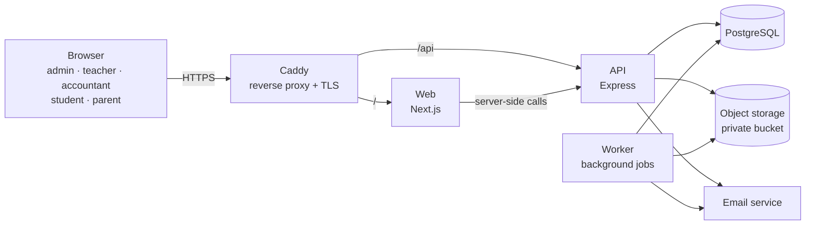
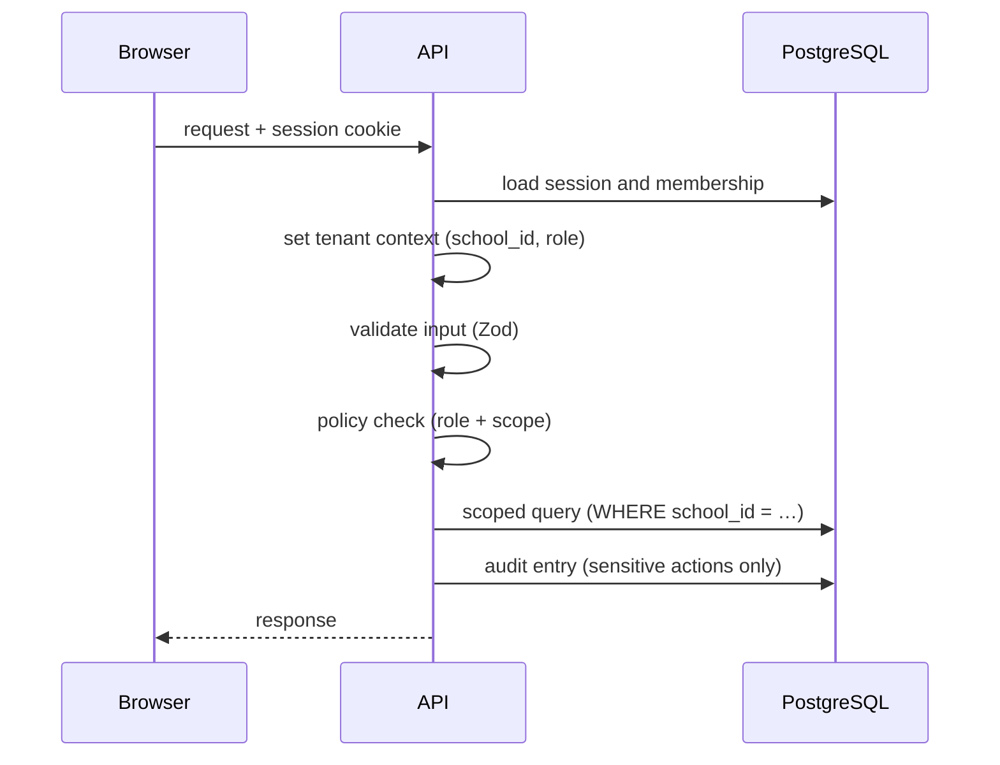

# Architecture

**Project:** School Management System
**Version:** 0.1 (draft)
**Date:** 31 Oct 2026
**Owner:** Hamzah Owaidat
**Issue:** #2 · Milestone M0
**Related:** [SRS](./srs.md) · [Decision records](./adr/)

---

## 1. Overview

The system is one web app used by many schools (multi-tenant SaaS). It is built as a **modular monolith**: one Next.js frontend, one Express API and one PostgreSQL database, with the API split into clear domain modules ([ADR 0001](./adr/0001-modular-monolith.md)).

Every school's data lives in the same database, and every tenant table has a `school_id` that the API always filters on ([ADR 0002](./adr/0002-multi-tenancy-model.md)).



---

## 2. Components

| Component | Technology | Responsibility |
|-----------|------------|----------------|
| Web | Next.js (App Router) + TypeScript | All screens for the 6 roles; Arabic (RTL), English and French |
| API | Express + TypeScript | Business rules, permissions, tenant isolation, audit log |
| Worker | Same codebase as the API, started in worker mode; jobs stored in PostgreSQL (pg-boss) | Exports, report generation, emails |
| Database | PostgreSQL + Prisma | All application data; one shared schema with `school_id` |
| Object storage | S3-compatible: MinIO locally, DigitalOcean Spaces in production | Uploaded files (materials, submissions, logos), always private |
| Email | Mailpit locally; a transactional email provider in production (to be chosen) | Invitations, email verification, password reset, notifications |
| Reverse proxy | Caddy | HTTPS, serves the web app at `/` and the API at `/api` on the same domain |

Web and API share one domain, so the session cookie is first-party and the browser never makes cross-origin calls.

---

## 3. Repository layout

A pnpm workspace monorepo, run with Turborepo:

```text
school-management-system/
├── apps/
│   ├── web/                 # Next.js frontend
│   │   ├── app/             # routes, grouped by role: (admin) (teacher) (accountant) (student) (parent)
│   │   ├── components/
│   │   ├── lib/             # API client, auth helpers
│   │   └── messages/        # translations: ar.json, en.json, fr.json
│   └── api/                 # Express API and worker
│       └── src/
│           ├── modules/     # one folder per domain module (see section 4)
│           ├── core/        # session, tenant context, policy, errors, logging, audit
│           ├── jobs/        # background job handlers
│           ├── app.ts       # Express app
│           ├── server.ts    # starts the API
│           └── worker.ts    # starts the worker
├── packages/
│   ├── config/              # shared TypeScript and ESLint configuration
│   ├── contracts/           # types, Zod schemas, permission keys, shared constants (web + API)
│   └── db/                  # Prisma schema, migrations, seed, tenant-scoped client (added in #7)
├── docs/                    # SRS, architecture, ERD, ADRs
├── docker-compose.yml       # local: PostgreSQL, MinIO, Mailpit
└── .github/                 # CI, templates
```

---

## 4. API modules

Each module owns its routes, validation, services and data access. A module may call another module's **service**, never its repository or tables directly.

| Module | Covers | SRS |
|--------|--------|-----|
| `auth` | Sign-in, sign-out, sessions, password reset, email verification | FR-01 |
| `access` | Roles, permissions, policy checks | FR-02 |
| `platform` | School tenants (platform operator) | FR-03 |
| `schools` | School settings, staff memberships | FR-04 |
| `academics` | Years, terms, grade levels, classes, subjects, teacher assignments | FR-05 |
| `people` | Student, teacher and guardian profiles, invitations | FR-06, FR-12 |
| `enrollment` | Enrollment and transfers | FR-06 |
| `materials` | Learning materials | FR-07 |
| `assignments` | Assignments, submissions, feedback | FR-08 |
| `attendance` | Attendance and correction history | FR-09 |
| `grading` | Scales, assessments, grade entry, publishing | FR-10 |
| `timetable` | Weekly timetable and overlap rules | FR-11 |
| `communication` | Announcements, notifications | FR-12 |
| `finance` | Fees, invoices, payments, allocation, reversals | FR-13 |
| `reports` | Reports and exports | FR-14 |
| `files` | Upload, private storage, signed download links | FR-07, FR-08 |
| `audit` | Audit log of sensitive actions | NFR-02 |

Inside a module:

```text
modules/attendance/
├── attendance.routes.ts      # URLs and middleware
├── attendance.controller.ts  # reads the request, calls the service
├── attendance.service.ts     # business rules
├── attendance.repository.ts  # Prisma queries (always tenant-scoped)
├── attendance.schemas.ts     # Zod input validation
└── attendance.test.ts
```

---

## 5. Key request flows

### 5.1 Every authenticated request



Any step that fails stops the request: no session → 401, wrong role or scope → 403, bad input → 400.

### 5.2 Sign-in

1. The user submits email and password to `POST /api/auth/login` (rate-limited).
2. The API checks the password hash (Argon2id) and that the user and school are active.
3. The API creates a session row and sets an httpOnly, Secure, SameSite=Lax cookie with a random session ID.
4. If the user belongs to several schools, they pick one; the choice is stored on the session.

Details: [ADR 0003](./adr/0003-authentication-and-sessions.md).

### 5.3 File upload and download

1. The user uploads through the API; it checks the permission, file size and type.
2. The API stores the file in the private bucket under `schools/<school_id>/<module>/<uuid>` and saves its metadata with `school_id`.
3. To download, the API checks the permission again and returns a signed link that expires after 5 minutes.

Details: [ADR 0004](./adr/0004-private-file-storage.md).

### 5.4 Recording a payment

1. The accountant submits a payment with an idempotency key generated by the browser.
2. The API stores the key with the payment; resending the same key returns the first result instead of a second payment.
3. The payment is allocated to open invoices; corrections are made by reversal, never by deleting.

---

## 6. Environments

| Environment | Where | Purpose |
|-------------|-------|---------|
| Local | Developer machine, Docker Compose (PostgreSQL, MinIO, Mailpit) | All development until the pilot school approves |
| Staging | DigitalOcean (after approval) | Test each release before production |
| Production | DigitalOcean droplet + Managed PostgreSQL + Spaces (after approval) | The pilot school |

Branches map to environments: `development` → local, `staging` → staging, `production` → production. Details: [ADR 0005](./adr/0005-hosting-and-deployment.md).

---

## 7. Decision records

| ADR | Decision | Status |
|-----|----------|--------|
| [0001](./adr/0001-modular-monolith.md) | Modular monolith | Accepted |
| [0002](./adr/0002-multi-tenancy-model.md) | Shared database, `school_id` on every tenant table | Accepted |
| [0003](./adr/0003-authentication-and-sessions.md) | Server-side sessions in httpOnly cookies | Accepted |
| [0004](./adr/0004-private-file-storage.md) | Private S3-compatible storage with signed links | Accepted |
| [0005](./adr/0005-hosting-and-deployment.md) | Local until approval, then DigitalOcean + Managed PostgreSQL | Accepted |
