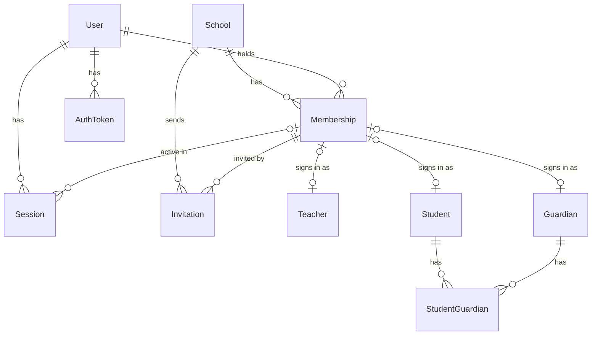
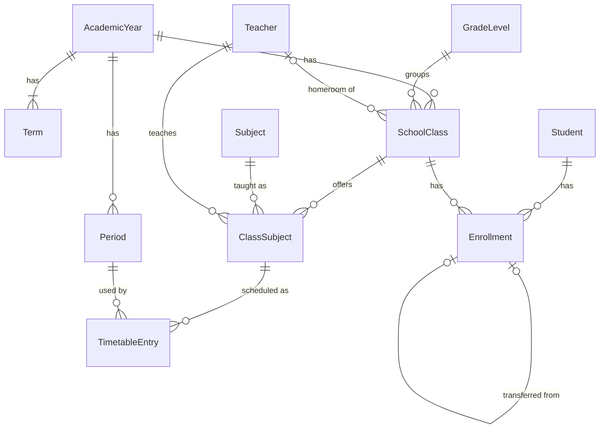
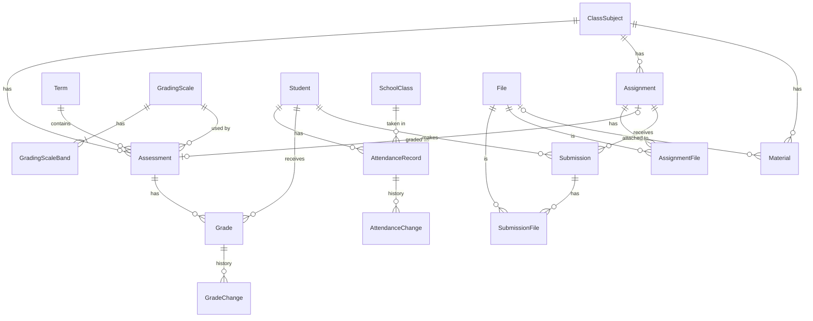
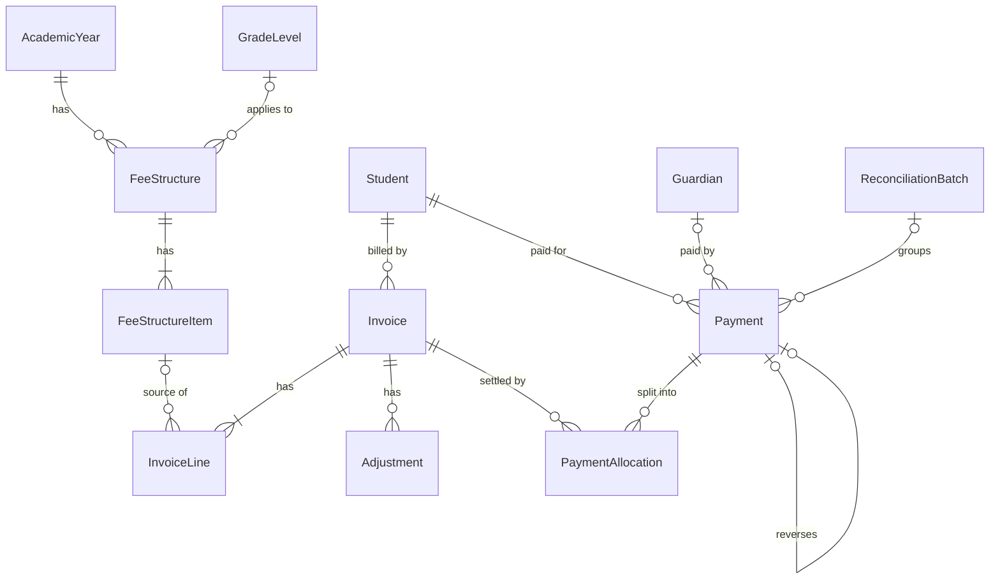
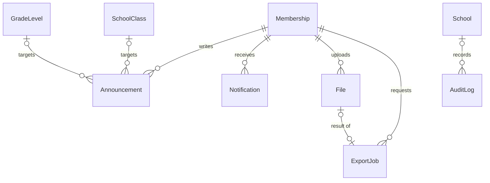

# Database design

**Project:** School Management System
**Version:** 0.1 (draft)
**Date:** 31 Oct 2026
**Owner:** Hamzah Owaidat
**Issue:** #3 · Milestone M0
**Related:** [SRS](./srs.md) · [Architecture](./architecture.md) · [ADR 0002 Multi-tenancy](./adr/0002-multi-tenancy-model.md)

---

## 1. Conventions

- **Database:** PostgreSQL, managed with Prisma.
- **Names:** Prisma models in `PascalCase` and fields in `camelCase`, mapped to `snake_case` tables and columns with `@@map` / `@map`.
- **IDs:** UUID primary keys on every table.
- **Timestamps:** every table has `createdAt`; tables whose rows change also have `updatedAt`.
- **Tenant tables:** every tenant table has a required `schoolId` and `@@unique([schoolId, id])`.
- **Money:** `BigInt` in the smallest currency unit plus a 3-letter `currency` code. `BigInt` is needed because LBP amounts go past the 32-bit integer limit.
- **Scores and weights:** `Decimal(6,2)` and `Decimal(5,2)`, never floating point.
- **Optional fields** are marked `?` below.
- **`SchoolClass`:** the model for a class (for example `8A`) is called `SchoolClass`, because `class` is a reserved word in JavaScript and in Mermaid diagrams. Its table is `classes` and other tables point to it with `classId`.

---

## 2. Tenant rules

Every entity has exactly one tenant rule:

- **Global:** no `schoolId`; shared by the whole platform.
- **Root:** the tenant itself (`School`).
- **Scoped:** required `schoolId`; every query is filtered by it through the tenant-scoped Prisma client.
- **Scoped or platform:** `schoolId` is optional; rows without one are platform-level and readable only by the platform operator.

The last column says how rows are removed (section 8).

| Area | Entity | Tenant rule | Removal |
|------|--------|-------------|---------|
| Identity | `User` | Global | Suspended, never deleted while memberships exist |
| Identity | `Session` | Global | Hard delete (expiry job) |
| Identity | `AuthToken` | Global | Hard delete (expiry job) |
| Identity | `School` | Root | Suspended; offboarding by script |
| Identity | `Membership` | Scoped | Suspended, never deleted |
| Identity | `Invitation` | Scoped | Hard delete (expiry job) |
| People | `Teacher` | Scoped | Soft delete |
| People | `Student` | Scoped | Soft delete, then anonymize on request |
| People | `Guardian` | Scoped | Soft delete |
| People | `StudentGuardian` | Scoped | Hard delete (link only) |
| Academics | `AcademicYear` | Scoped | Archive |
| Academics | `Term` | Scoped | Never deleted once used |
| Academics | `GradeLevel` | Scoped | Archive |
| Academics | `Subject` | Scoped | Archive |
| Academics | `SchoolClass` | Scoped | Archive |
| Academics | `ClassSubject` | Scoped | Hard delete only if unused |
| Academics | `Enrollment` | Scoped | Never deleted; status changes |
| Timetable | `Period` | Scoped | Hard delete only if unused |
| Timetable | `TimetableEntry` | Scoped | Hard delete |
| Files | `File` | Scoped | Soft delete, then object purged |
| Teaching | `Material` | Scoped | Soft delete |
| Teaching | `Assignment` | Scoped | Soft delete |
| Teaching | `AssignmentFile` | Scoped | Hard delete (link only) |
| Teaching | `Submission` | Scoped | Never deleted |
| Teaching | `SubmissionFile` | Scoped | Hard delete (link only) |
| Attendance | `AttendanceRecord` | Scoped | Never deleted; corrected with history |
| Attendance | `AttendanceChange` | Scoped | Append-only |
| Grading | `GradingScale` | Scoped | Archive |
| Grading | `GradingScaleBand` | Scoped | Hard delete with its scale |
| Grading | `Assessment` | Scoped | Hard delete only while it has no grades |
| Grading | `Grade` | Scoped | Never deleted; corrected with history |
| Grading | `GradeChange` | Scoped | Append-only |
| Communication | `Announcement` | Scoped | Soft delete |
| Communication | `Notification` | Scoped | Hard delete (retention job) |
| Finance | `FeeStructure` | Scoped | Archive |
| Finance | `FeeStructureItem` | Scoped | Hard delete only if never invoiced |
| Finance | `Invoice` | Scoped | Drafts deleted; issued ones voided, never deleted |
| Finance | `InvoiceLine` | Scoped | Deleted only with a draft invoice |
| Finance | `Adjustment` | Scoped | Append-only |
| Finance | `Payment` | Scoped | Append-only; reversed, never deleted |
| Finance | `PaymentAllocation` | Scoped | Append-only; reversed, never deleted |
| Finance | `ReconciliationBatch` | Scoped | Never deleted once closed |
| Finance | `DocumentSequence` | Scoped | Never deleted |
| System | `ExportJob` | Scoped | Hard delete (retention job) |
| System | `AuditLog` | Scoped or platform | Append-only; retention job |

Background jobs live in the `pgboss` schema, which pg-boss manages outside Prisma. Every job payload carries `schoolId`, and the worker uses the tenant-scoped client.

---

## 3. Entity relationship diagrams

Every Scoped entity also belongs to `School`; that relation is not drawn, to keep the diagrams readable.

### 3.1 Identity and people



### 3.2 Academic structure, enrollment and timetable



### 3.3 Teaching, attendance and grading



### 3.4 Finance



### 3.5 Communication and system



---

## 4. Entities

Every Scoped entity also has `id`, `schoolId`, `createdAt` and, where rows change, `updatedAt`. Only the other fields are listed.

### 4.1 Identity

- **User** (Global): `email` (unique, stored lowercase), `passwordHash`, `emailVerifiedAt?`, `status: ACTIVE | SUSPENDED`, `isPlatformOperator` (default false), `locale?: ar | en | fr`, `lastLoginAt?`
- **Session** (Global): `userId`, `tokenHash` (unique), `activeMembershipId?`, `ip?`, `userAgent?`, `lastSeenAt`, `idleExpiresAt`, `absoluteExpiresAt`
- **AuthToken** (Global): `userId`, `type: EMAIL_VERIFICATION | PASSWORD_RESET`, `tokenHash` (unique), `expiresAt`, `usedAt?`
- **School** (Root): `name`, `slug` (unique), `status: ACTIVE | SUSPENDED`, `defaultLocale`, `timezone` (default `Asia/Beirut`), `currency`, `logoFileId?`, `suspendedAt?`
- **Membership**: `userId`, `role: SCHOOL_ADMIN | TEACHER | ACCOUNTANT | STUDENT | PARENT`, `status: ACTIVE | SUSPENDED`; unique `(schoolId, userId, role)`
- **Invitation**: `email`, `role`, `tokenHash` (unique), `invitedByMembershipId`, `teacherId?`, `studentId?`, `guardianId?`, `expiresAt`, `acceptedAt?`, `revokedAt?`

The platform operator is `User.isPlatformOperator`, not a membership, so that role never enters a school's tenant context.

### 4.2 People

- **Teacher**: `membershipId?` (unique), `firstName`, `lastName`, `firstNameAr?`, `lastNameAr?`, `phone?`, `status: ACTIVE | INACTIVE`, `deletedAt?`
- **Student**: `membershipId?` (unique), `studentNumber` (unique per school), `firstName`, `lastName`, `firstNameAr?`, `lastNameAr?`, `dateOfBirth?`, `status: ACTIVE | GRADUATED | WITHDRAWN`, `deletedAt?`, `anonymizedAt?`
- **Guardian**: `membershipId?` (unique), `firstName`, `lastName`, `phone?`, `email?`, `deletedAt?`
- **StudentGuardian**: `studentId`, `guardianId`, `relationship: FATHER | MOTHER | GUARDIAN | OTHER`, `isPrimary`; unique `(schoolId, studentId, guardianId)`

Profiles exist without an account: a young student may never sign in. `membershipId` is set when an invitation is accepted.

### 4.3 Academic structure and enrollment

- **AcademicYear**: `name` (for example `2026–2027`), `startDate`, `endDate`, `isActive`, `archivedAt?`; at most one active year per school
- **Term**: `academicYearId`, `name`, `order`, `startDate`, `endDate`, `gradesLockedAt?`
- **GradeLevel**: `name`, `order`, `archivedAt?`
- **Subject**: `name`, `code?`, `archivedAt?`; unique `(schoolId, name)`
- **SchoolClass**: `academicYearId`, `gradeLevelId`, `name` (for example `8A`), `homeroomTeacherId?`, `capacity?`, `archivedAt?`; unique `(schoolId, academicYearId, name)`
- **ClassSubject**: `classId`, `subjectId`, `teacherId`; unique `(schoolId, classId, subjectId)`. This is the unit that materials, assignments, assessments and the timetable attach to.
- **Enrollment**: `studentId`, `classId`, `academicYearId`, `status: ACTIVE | TRANSFERRED | WITHDRAWN | COMPLETED`, `startDate`, `endDate?`, `transferredFromId?`; at most one active enrollment per student per year

`Enrollment.academicYearId` copies the class's year so the "one active enrollment per year" rule can be a database index. The service sets it from the class.

### 4.4 Timetable

- **Period**: `academicYearId`, `number`, `startTime`, `endTime`; unique `(schoolId, academicYearId, number)`
- **TimetableEntry**: `classSubjectId`, `classId`, `teacherId`, `periodId`, `dayOfWeek` (1–7), `room?`

`classId` and `teacherId` are copied from the `ClassSubject` so the database can refuse double-booking (section 7). When a class subject's teacher changes, the service updates its timetable entries in the same transaction.

### 4.5 Files and teaching

- **File**: `uploadedByMembershipId`, `module: MATERIAL | ASSIGNMENT | SUBMISSION | LOGO | EXPORT`, `storageKey` (unique), `originalName`, `mimeType`, `sizeBytes`, `checksumSha256`, `deletedAt?`, `purgedAt?`
- **Material**: `classSubjectId`, `createdByTeacherId`, `title`, `description?`, `type: FILE | LINK`, `fileId?`, `url?`, `publishedAt?`, `deletedAt?`
- **Assignment**: `classSubjectId`, `createdByTeacherId`, `title`, `instructions?`, `dueAt`, `maxScore?`, `publishedAt?`, `deletedAt?`
- **AssignmentFile**: `assignmentId`, `fileId`; unique `(schoolId, assignmentId, fileId)`
- **Submission**: `assignmentId`, `studentId`, `status: SUBMITTED | RETURNED`, `text?`, `submittedAt`, `isLate`, `score?`, `feedback?`, `returnedAt?`, `returnedByTeacherId?`; unique `(schoolId, assignmentId, studentId)`
- **SubmissionFile**: `submissionId`, `fileId`; unique `(schoolId, submissionId, fileId)`

### 4.6 Attendance

- **AttendanceRecord**: `studentId`, `classId`, `date`, `period` (0 = whole day), `status: PRESENT | ABSENT | LATE | EXCUSED`, `note?`, `recordedByMembershipId`; unique `(schoolId, studentId, date, period)`
- **AttendanceChange**: `attendanceRecordId`, `oldStatus`, `newStatus`, `reason`, `changedByMembershipId`, `changedAt`

`period = 0` supports daily attendance; `period = 1…n` supports attendance per period, so either answer to the SRS open question fits.

### 4.7 Grading

- **GradingScale**: `name`, `maxScore` (for example 20 or 100), `passScore`, `isDefault`, `archivedAt?`
- **GradingScaleBand**: `gradingScaleId`, `label` (for example `A`), `minPercent`, `maxPercent`
- **Assessment**: `classSubjectId`, `termId`, `gradingScaleId`, `createdByTeacherId`, `assignmentId?`, `title`, `type: EXAM | QUIZ | HOMEWORK | PROJECT | OTHER`, `maxScore`, `weight`, `date?`, `status: DRAFT | PUBLISHED`, `publishedAt?`
- **Grade**: `assessmentId`, `studentId`, `score?`, `isExcused`, `comment?`, `enteredByMembershipId`; unique `(schoolId, assessmentId, studentId)`
- **GradeChange**: `gradeId`, `oldScore?`, `newScore?`, `oldExcused`, `newExcused`, `reason`, `changedByMembershipId`, `changedAt`

### 4.8 Communication

- **Announcement**: `authorMembershipId`, `title`, `body`, `audience: SCHOOL | GRADE_LEVEL | CLASS | ROLE`, `gradeLevelId?`, `classId?`, `role?`, `publishedAt?`, `expiresAt?`, `deletedAt?`
- **Notification**: `recipientMembershipId`, `type`, `title`, `body`, `link?`, `readAt?`

### 4.9 Finance

- **FeeStructure**: `academicYearId`, `gradeLevelId?`, `name`, `currency`, `archivedAt?`
- **FeeStructureItem**: `feeStructureId`, `name`, `amountMinor`, `dueDate?`, `order`
- **Invoice**: `studentId`, `academicYearId`, `createdByMembershipId`, `number?` (set when issued; unique per school), `currency`, `status: DRAFT | ISSUED | PARTIALLY_PAID | PAID | VOID`, `issueDate?`, `dueDate?`, `totalMinor`, `adjustedMinor` (default 0), `paidMinor` (default 0), `notes?`, `voidedAt?`, `voidReason?`
- **InvoiceLine**: `invoiceId`, `feeStructureItemId?`, `description`, `quantity`, `unitAmountMinor`, `amountMinor`
- **Adjustment**: `invoiceId`, `type: DISCOUNT | WAIVER | CORRECTION`, `amountMinor` (negative lowers what is owed), `reason`, `createdByMembershipId`
- **Payment**: `studentId`, `payerGuardianId?`, `recordedByMembershipId`, `amountMinor` (negative only for a reversal), `currency`, `method: CASH | CHEQUE | BANK_TRANSFER | OTHER`, `reference?`, `receivedAt`, `receiptNumber`, `idempotencyKey`, `reversesPaymentId?` (unique), `reason?` (required for a reversal), `reconciliationBatchId?`; unique `(schoolId, receiptNumber)` and `(schoolId, idempotencyKey)`
- **PaymentAllocation**: `paymentId`, `invoiceId`, `amountMinor` (negative = a reversal), `reversesAllocationId?` (unique), `createdByMembershipId`
- **ReconciliationBatch**: `method`, `currency`, `periodStart`, `periodEnd`, `expectedMinor`, `countedMinor`, `note?`, `closedAt?`, `closedByMembershipId?`
- **DocumentSequence**: `type: INVOICE | RECEIPT`, `year`, `nextValue`; primary key `(schoolId, type, year)`

### 4.10 System

- **ExportJob**: `requestedByMembershipId`, `type`, `params` (JSON), `status: QUEUED | RUNNING | DONE | FAILED`, `fileId?`, `error?`, `finishedAt?`, `expiresAt?`
- **AuditLog**: `schoolId?`, `actorUserId?`, `actorMembershipId?`, `action` (for example `grade.update`), `entityType`, `entityId`, `before?` (JSON), `after?` (JSON), `reason?`, `ip?`, `userAgent?`, `createdAt`. It has no foreign keys on purpose, so entries survive when the rows they describe are purged.

---

## 5. Composite tenant keys

Every Scoped table has `@@unique([schoolId, id])`. A **required** relation between two Scoped tables uses both columns, so a row can only point to a row in the same school:

```prisma
model SchoolClass {
  id             String @id @default(uuid()) @db.Uuid
  schoolId       String @db.Uuid
  academicYearId String @db.Uuid
  gradeLevelId   String @db.Uuid
  name           String

  school       School       @relation(fields: [schoolId], references: [id], onDelete: Restrict)
  academicYear AcademicYear @relation(fields: [schoolId, academicYearId], references: [schoolId, id], onDelete: Restrict)
  gradeLevel   GradeLevel   @relation(fields: [schoolId, gradeLevelId], references: [schoolId, id], onDelete: Restrict)

  @@unique([schoolId, id])
  @@unique([schoolId, academicYearId, name])
  @@index([schoolId, gradeLevelId])
  @@map("classes")
}
```

An **optional** relation can't share the required `schoolId` in a Prisma relation. So:

1. In Prisma, the optional relation uses the id alone (for example `homeroomTeacherId → Teacher.id`).
2. The migration SQL adds the composite foreign key by hand:
   `FOREIGN KEY (school_id, homeroom_teacher_id) REFERENCES teachers (school_id, id) ON DELETE RESTRICT`.
   PostgreSQL skips the check while `homeroom_teacher_id` is null.

Optional relations handled this way: `SchoolClass.homeroomTeacherId`, `Teacher/Student/Guardian.membershipId`, `Invitation.teacherId/studentId/guardianId`, `Enrollment.transferredFromId`, `Material.fileId`, `Assessment.assignmentId`, `Submission.returnedByTeacherId`, `Announcement.gradeLevelId/classId`, `InvoiceLine.feeStructureItemId`, `Payment.payerGuardianId/reversesPaymentId/reconciliationBatchId`, `PaymentAllocation.reversesAllocationId`, `ReconciliationBatch.closedByMembershipId`, `ExportJob.fileId`.

`SET NULL` is never used on a composite key, because it would also try to clear `school_id`.

---

## 6. Relations and delete policies

**Default: Restrict.** A parent row can't be deleted while children point to it.

- **Cascade** is used only where the child has no meaning or history of its own.
- **Set null** is used only on single-column keys from global tables.

Every Scoped table's `schoolId → School`: **Restrict** (schools are suspended, never deleted by a cascade).

| Child → Parent | Required | On delete | Why |
|----------------|----------|-----------|-----|
| `Session.userId → User` | Yes | Cascade | Sessions mean nothing without the user |
| `Session.activeMembershipId → Membership` | No | Set null | Global table, single-column key |
| `AuthToken.userId → User` | Yes | Cascade | Tokens mean nothing without the user |
| `School.logoFileId → File` | No | Set null | Root table, single-column key |
| `Membership.userId → User` | Yes | Restrict | Users with memberships are suspended, not deleted |
| `Invitation.invitedByMembershipId → Membership` | Yes | Restrict | Keeps who invited whom |
| `Invitation.teacherId / studentId / guardianId → profile` | No | Restrict | Invitations are removed by their own expiry job |
| `Teacher / Student / Guardian.membershipId → Membership` | No | Restrict | Memberships are never deleted |
| `StudentGuardian.studentId → Student` | Yes | Cascade | Link only |
| `StudentGuardian.guardianId → Guardian` | Yes | Cascade | Link only |
| `Term.academicYearId → AcademicYear` | Yes | Restrict | Terms carry grades |
| `SchoolClass.academicYearId → AcademicYear` | Yes | Restrict | History |
| `SchoolClass.gradeLevelId → GradeLevel` | Yes | Restrict | History |
| `SchoolClass.homeroomTeacherId → Teacher` | No | Restrict | Reassign first |
| `ClassSubject.classId → SchoolClass` | Yes | Restrict | Teaching history |
| `ClassSubject.subjectId → Subject` | Yes | Restrict | Teaching history |
| `ClassSubject.teacherId → Teacher` | Yes | Restrict | Reassign first |
| `Enrollment.studentId → Student` | Yes | Restrict | Enrollment history |
| `Enrollment.classId → SchoolClass` | Yes | Restrict | Enrollment history |
| `Enrollment.academicYearId → AcademicYear` | Yes | Restrict | Enrollment history |
| `Enrollment.transferredFromId → Enrollment` | No | Restrict | Transfer history |
| `Period.academicYearId → AcademicYear` | Yes | Restrict | Timetable |
| `TimetableEntry.classSubjectId → ClassSubject` | Yes | Cascade | A plan with no history value |
| `TimetableEntry.periodId → Period` | Yes | Restrict | Avoid silently emptying the timetable |
| `TimetableEntry.classId → SchoolClass` | Yes | Restrict | Copied key for overlap rules |
| `TimetableEntry.teacherId → Teacher` | Yes | Restrict | Copied key for overlap rules |
| `File.uploadedByMembershipId → Membership` | Yes | Restrict | Ownership |
| `Material.classSubjectId → ClassSubject` | Yes | Restrict | Soft-deleted instead |
| `Material.createdByTeacherId → Teacher` | Yes | Restrict | Authorship |
| `Material.fileId → File` | No | Restrict | Files are soft-deleted |
| `Assignment.classSubjectId → ClassSubject` | Yes | Restrict | Soft-deleted instead |
| `Assignment.createdByTeacherId → Teacher` | Yes | Restrict | Authorship |
| `AssignmentFile.assignmentId → Assignment` | Yes | Cascade | Link only |
| `AssignmentFile.fileId → File` | Yes | Restrict | Files are soft-deleted |
| `Submission.assignmentId → Assignment` | Yes | Restrict | Student work is kept |
| `Submission.studentId → Student` | Yes | Restrict | Student work is kept |
| `Submission.returnedByTeacherId → Teacher` | No | Restrict | Authorship |
| `SubmissionFile.submissionId → Submission` | Yes | Cascade | Link only |
| `SubmissionFile.fileId → File` | Yes | Restrict | Files are soft-deleted |
| `AttendanceRecord.studentId → Student` | Yes | Restrict | Attendance history |
| `AttendanceRecord.classId → SchoolClass` | Yes | Restrict | Attendance history |
| `AttendanceRecord.recordedByMembershipId → Membership` | Yes | Restrict | Who recorded it |
| `AttendanceChange.attendanceRecordId → AttendanceRecord` | Yes | Restrict | Append-only history |
| `AttendanceChange.changedByMembershipId → Membership` | Yes | Restrict | Who changed it |
| `GradingScaleBand.gradingScaleId → GradingScale` | Yes | Cascade | Part of the scale |
| `Assessment.classSubjectId → ClassSubject` | Yes | Restrict | Grade history |
| `Assessment.termId → Term` | Yes | Restrict | Grade history |
| `Assessment.gradingScaleId → GradingScale` | Yes | Restrict | Grade history |
| `Assessment.createdByTeacherId → Teacher` | Yes | Restrict | Authorship |
| `Assessment.assignmentId → Assignment` | No | Restrict | Link to graded work |
| `Grade.assessmentId → Assessment` | Yes | Restrict | Grade history |
| `Grade.studentId → Student` | Yes | Restrict | Grade history |
| `Grade.enteredByMembershipId → Membership` | Yes | Restrict | Who entered it |
| `GradeChange.gradeId → Grade` | Yes | Restrict | Append-only history |
| `GradeChange.changedByMembershipId → Membership` | Yes | Restrict | Who changed it |
| `Announcement.authorMembershipId → Membership` | Yes | Restrict | Authorship |
| `Announcement.gradeLevelId / classId → target` | No | Restrict | Soft-deleted instead |
| `Notification.recipientMembershipId → Membership` | Yes | Cascade | No history value |
| `FeeStructure.academicYearId → AcademicYear` | Yes | Restrict | Finance history |
| `FeeStructure.gradeLevelId → GradeLevel` | No | Restrict | Finance history |
| `FeeStructureItem.feeStructureId → FeeStructure` | Yes | Cascade | Blocked anyway once an item is invoiced |
| `Invoice.studentId → Student` | Yes | Restrict | Finance history |
| `Invoice.academicYearId → AcademicYear` | Yes | Restrict | Finance history |
| `Invoice.createdByMembershipId → Membership` | Yes | Restrict | Who created it |
| `InvoiceLine.invoiceId → Invoice` | Yes | Cascade | Only draft invoices can be deleted |
| `InvoiceLine.feeStructureItemId → FeeStructureItem` | No | Restrict | Finance history |
| `Adjustment.invoiceId → Invoice` | Yes | Restrict | Append-only |
| `Payment.studentId → Student` | Yes | Restrict | Append-only |
| `Payment.payerGuardianId → Guardian` | No | Restrict | Append-only |
| `Payment.recordedByMembershipId → Membership` | Yes | Restrict | Who recorded it |
| `Payment.reversesPaymentId → Payment` | No | Restrict | Reversal history |
| `Payment.reconciliationBatchId → ReconciliationBatch` | No | Restrict | Reconciliation history |
| `PaymentAllocation.paymentId → Payment` | Yes | Restrict | Append-only |
| `PaymentAllocation.invoiceId → Invoice` | Yes | Restrict | Append-only |
| `PaymentAllocation.reversesAllocationId → PaymentAllocation` | No | Restrict | Reversal history |
| `ReconciliationBatch.closedByMembershipId → Membership` | No | Restrict | Who closed it |
| `ExportJob.requestedByMembershipId → Membership` | Yes | Restrict | Who asked for it |
| `ExportJob.fileId → File` | No | Restrict | Files are soft-deleted |

---

## 7. Indexes

PostgreSQL does not index foreign keys automatically, so every foreign key gets an index **starting with `schoolId`**. The `(schoolId, id)` unique key also serves lookups by id.

### 7.1 School scope and sign-in

| Table | Index | Purpose |
|-------|-------|---------|
| `User` | unique `(email)` | Sign-in |
| `Session` | unique `(tokenHash)`, `(userId)` | Session lookup, sign out everywhere |
| `Membership` | unique `(schoolId, userId, role)`, `(userId)` | Schools a user belongs to |
| `Student` | unique `(schoolId, studentNumber)`, `(schoolId, lastName, firstName)` | Lookup and search |
| `StudentGuardian` | `(schoolId, guardianId)` | A parent's children |

### 7.2 Active year

| Table | Index | Purpose |
|-------|-------|---------|
| `AcademicYear` | unique `(schoolId)` where `isActive` (partial) | At most one active year |
| `SchoolClass` | `(schoolId, academicYearId, gradeLevelId)` | Classes of the active year |
| `Enrollment` | unique `(schoolId, studentId, academicYearId)` where `status = 'ACTIVE'` (partial) | At most one active enrollment per year |
| `Enrollment` | `(schoolId, classId, status)` | Class lists |
| `ClassSubject` | `(schoolId, teacherId)` | A teacher's classes |
| `Assessment` | `(schoolId, classSubjectId, termId)` | Gradebook |
| `TimetableEntry` | unique `(schoolId, classId, dayOfWeek, periodId)` | A class can't have two lessons at once |
| `TimetableEntry` | unique `(schoolId, teacherId, dayOfWeek, periodId)` | A teacher can't be double-booked |
| `TimetableEntry` | unique `(schoolId, room, dayOfWeek, periodId)` where `room IS NOT NULL` (partial) | A room can't be double-booked |

### 7.3 Reports and daily screens

| Table | Index | Purpose |
|-------|-------|---------|
| `AttendanceRecord` | unique `(schoolId, studentId, date, period)` | One mark per student per slot |
| `AttendanceRecord` | `(schoolId, classId, date)` | Daily class sheet, attendance reports |
| `Grade` | unique `(schoolId, assessmentId, studentId)`, `(schoolId, studentId)` | Gradebook, student report |
| `Submission` | unique `(schoolId, assignmentId, studentId)` | One submission per student |
| `Invoice` | unique `(schoolId, number)`, `(schoolId, studentId, status)` | Student balance |
| `Invoice` | `(schoolId, dueDate)` where `status IN ('ISSUED', 'PARTIALLY_PAID')` (partial) | Overdue report |
| `Payment` | unique `(schoolId, receiptNumber)`, unique `(schoolId, idempotencyKey)` | Receipts, no double posting |
| `Payment` | `(schoolId, receivedAt)`, `(schoolId, studentId)` | Daily collections, student history |
| `PaymentAllocation` | `(schoolId, invoiceId)`, `(schoolId, paymentId)` | Balances |
| `Notification` | `(schoolId, recipientMembershipId, readAt)` | Unread count |
| `AuditLog` | `(schoolId, createdAt)`, `(schoolId, entityType, entityId)` | Audit screens, a record's history |

Partial indexes (marked "partial") are written by hand in the migration SQL.

---

## 8. Soft delete and retention

### 8.1 Soft delete

- Soft-deleted rows have `deletedAt` set. The tenant-scoped client hides them by default; admin screens can show them.
- Unique rules on soft-deleted tables apply only to live rows (partial index `WHERE deleted_at IS NULL`).
- **Archive** (`archivedAt`) is for setup data (years, grade levels, subjects, classes, scales, fee structures): hidden from pickers, kept for history.
- Grades, attendance, submissions, enrollments and finance rows are **never** soft-deleted; they change through status or history rows.

### 8.2 Retention

A daily cleanup job applies these rules:

| Data | Rule |
|------|------|
| Sessions | Deleted 30 days after expiry |
| Email tokens | Deleted 7 days after use or expiry |
| Invitations | Deleted 30 days after acceptance, revocation or expiry |
| Notifications | Deleted 180 days after creation |
| Export files | Object purged at `expiresAt` (7 days); job row deleted after 90 days |
| Soft-deleted files | Object removed from storage 30 days after `deletedAt`; the row stays with `purgedAt` |
| Students | Never hard-deleted while they have academic or finance records. On a deletion request, personal fields are anonymized (names replaced, date of birth cleared, `anonymizedAt` set) and records stay linked to the anonymized row |
| Grades, attendance, enrollment | Kept for the life of the school account (proposed; confirm with the school) |
| Finance records | Never deleted; kept at least 10 years (proposed; confirm with the school's accountant) |
| Audit log | 2 years; grade and finance entries kept as long as those records |
| Suspended school | Data kept 90 days, then exported for the school and removed by a documented script, never by cascades |
| Database backups | Provider backups plus a nightly `pg_dump` to Spaces kept 30 days, to meet SRS NFR-04 (check the provider's own retention, which may be shorter) |

---

## 9. Finance history rules

1. **Money format.** Amounts are `BigInt` in the smallest unit, always with `currency`. An invoice has one currency, and a payment can only be allocated to an invoice in the same currency. There is no currency conversion in v1.
2. **Draft vs issued.** A draft invoice can be edited or deleted. Issuing assigns the next number and freezes the invoice and its lines.
3. **Corrections to issued invoices** are `Adjustment` rows with a reason. An invoice can be voided (with a reason) only if nothing is allocated to it.
4. **Payments are never edited or deleted.** A reversal is a new `Payment` with the negative amount, `reversesPaymentId` and a required reason. Its allocations are reversed by negative `PaymentAllocation` rows.
5. **Allocation limits.** Allocations never exceed the payment's amount or the invoice's open balance. Enforced in one transaction that locks the invoice row (`SELECT … FOR UPDATE`).
6. **Idempotency.** `(schoolId, idempotencyKey)` is unique, so a repeated request returns the existing payment.
7. **Numbering.** Invoice and receipt numbers come from `DocumentSequence`, locked per school, type and year, so they are gapless and never reused.
8. **Balances** are computed from invoices, adjustments and allocations. `Invoice.paidMinor`, `adjustedMinor` and `status` are caches updated in the same transaction.
9. **Reconciliation.** A closed batch is locked. A later reversal of one of its payments appears in the next batch.
10. **Audit.** Every finance write adds an `AuditLog` entry with the before and after values.

---

## 10. Grading and attendance history rules

### 10.1 Grades

1. While an assessment is `DRAFT`, its assigned teacher can enter and change grades freely; students and parents see nothing.
2. Publishing sets `status = PUBLISHED` and `publishedAt`; grades become visible to students and parents.
3. After publishing, every change needs a reason and writes a `GradeChange` row and an `AuditLog` entry.
4. When a term is locked (`Term.gradesLockedAt`), only a school admin can change its grades, still with a reason.
5. Grades are never deleted. A grade that no longer counts is marked `isExcused` or cleared through a change with a reason.
6. An assessment can be deleted only while it has no grades.
7. Term averages are computed from published grades and assessment weights, not stored. Report-card snapshots would be added if report cards join v1.
8. After a transfer, grades stay with the assessments of the old class, so the student's history is complete.

### 10.2 Attendance

1. A teacher can change today's records for their own classes without a reason.
2. Any change to an earlier day needs a reason and writes an `AttendanceChange` row (old status, new status, who, when, why).
3. Attendance records are never deleted.

---

## 11. Open questions that affect the schema

| Question (from the SRS) | How the schema copes now |
|-------------------------|--------------------------|
| USD, LBP or both? | `currency` on every money row; one currency per invoice |
| Marks out of 20, out of 100, or letters? | `GradingScale.maxScore` plus optional letter bands |
| Names in Arabic and Latin script? | Optional `firstNameAr` / `lastNameAr` fields |
| Attendance per day or per period? | `period` field: 0 = whole day, 1…n = period |
| Report cards in v1? | Would add a `TermResult` snapshot table |
| How long must records be kept? | Proposed periods in section 8.2, to confirm with the school |