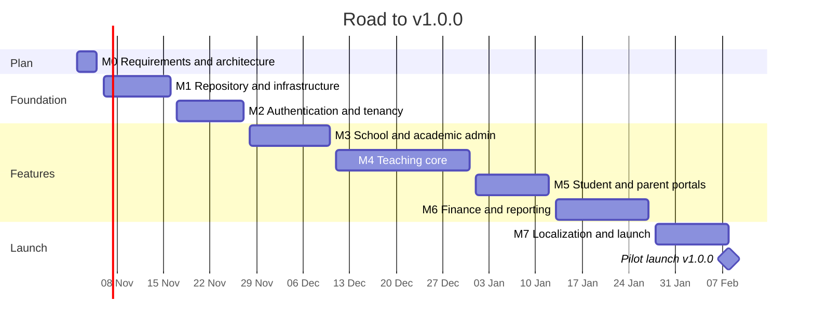

# Implementation roadmap

**Project:** School Management System
**Version:** 0.1
**Date:** 31 Oct 2026
**Owner:** Hamzah Owaidat
**Issue:** #4 · Milestone M0
**Related:** [SRS](./srs.md) · [Decisions](./decisions.md) · Project board: GitHub Projects "School Management System"

Eight milestones take the project from requirements to the pilot school launch, **v1.0.0 on 8 Feb 2027**. Each milestone ends with a tagged release.

---

## 1. Timeline

---

## 2. Milestones

| Milestone                        | Due         | Release | Issues                 | Done when                                                                                                 |
| -------------------------------- | ----------- | ------- | ---------------------- | --------------------------------------------------------------------------------------------------------- |
| M0 Requirements and architecture | 5 Nov 2026  | —       | #1–#4                  | SRS, architecture, ADRs, database design, permissions and decisions merged                                |
| M1 Repository and infrastructure | 16 Nov 2026 | v0.1.0  | #5–#11                 | Monorepo runs locally with one command; CI green on every PR                                              |
| M2 Authentication and tenancy    | 27 Nov 2026 | v0.2.0  | #12–#20                | Sign-in, sessions, roles and tenant isolation work; cross-tenant tests pass                               |
| M3 School and academic admin     | 10 Dec 2026 | v0.3.0  | #21–#29                | An admin sets up a full school year, staff, students and enrollment                                       |
| M4 Teaching core                 | 31 Dec 2026 | v0.4.0  | #30–#43                | Teachers run materials, assignments, attendance, grades and timetable                                     |
| M5 Student and parent portals    | 12 Jan 2027 | v0.5.0  | #44–#50                | Students and parents see their own data only; announcements work                                          |
| M6 Finance and reporting         | 27 Jan 2027 | v0.6.0  | #51–#61 + report cards | Fees, invoices, payments, reports, exports and report cards work                                          |
| M7 Localization and launch       | 8 Feb 2027  | v1.0.0  | #62–#69                | Arabic, English and French complete; security, accessibility and load checks pass; pilot school onboarded |

---

## 3. Changes from the M0 decisions

| Change                                                                 | Why                                                         | Where                      |
| ---------------------------------------------------------------------- | ----------------------------------------------------------- | -------------------------- |
| Add an issue "Build report card generation"                            | Report cards are in v1                                      | D-06 · M6, after #60       |
| Do #41 (timetable API) **before** #36 (attendance API)                 | Attendance is taken per period, so periods must exist first | D-05 · M4                  |
| Choose the email provider before #14                                   | Password reset and verification send email                  | D-10 · M2                  |
| Run #10 and #11 as local production builds                             | No servers until the pilot school approves                  | D-16 · M1                  |
| Build multi-currency and the grading scale type into the first schemas | USD and LBP; each school picks its scale                    | D-02, D-04 · #12, #38, #51 |

---

## 4. How each issue is worked

1. Move the issue to **In Progress** on the board.
2. Create a branch from `development`: `<type>/<issue>-<short-name>` (for example `feat/13-login`, `docs/4-permissions-decisions`).
3. Commit with the type prefix used so far (`docs:`, `feat:`, `fix:`, `chore:`, `test:`).
4. Open a pull request into `development` with `Closes #<issue>` in the description.
5. **Squash and merge** when the checks pass, then delete the branch.

---

## 5. Definition of ready

An issue can be started when every box is true:

- [ ] Its goal and "done when" are written in the issue.
- [ ] It links to the SRS requirement (FR or NFR) it delivers, or is marked as setup work.
- [ ] Every data change it needs is in the [database design](./database-design.md).
- [ ] Every permission it needs is in the [permissions matrix](./permissions.md).
- [ ] Every decision it depends on is Decided or Proposed in the [decisions log](./decisions.md), not Open.
- [ ] The issues it depends on are done.
- [ ] It fits in about one working day; if not, it is split.
- [ ] It has a milestone, labels and an assignee.

### Check for M1

| Issue                                          | Depends on                                          | Ready                        |
| ---------------------------------------------- | --------------------------------------------------- | ---------------------------- |
| #5 Scaffold the monorepo                       | M0 (repository layout in the architecture document) | Yes                          |
| #6 Add code quality tooling                    | #5                                                  | Yes, after #5                |
| #7 Set up the local environment and database   | #5; ADR 0005 (PostgreSQL, MinIO, Mailpit)           | Yes, after #5                |
| #8 Build the API foundation                    | #5, #7                                              | Yes, after #7                |
| #9 Create the CI pipeline                      | #6                                                  | Yes, after #6                |
| #10 Set up staging and production environments | D-16: local production build only                   | Yes, with the narrowed scope |
| #11 Release v0.1.0 to staging                  | #5–#10                                              | Yes, after #10               |

Issues #6 to #11 need an assignee on the board.

---

## 6. Definition of done

An issue is done when:

- [ ] Its "done when" items are met.
- [ ] Lint, type check and tests pass in CI.
- [ ] API changes check permissions and school scope on the server, with tests for another school's data.
- [ ] UI changes work in Arabic (right-to-left), English and French, and at phone width.
- [ ] No secrets, tokens or real student data are in the code or logs.
- [ ] Docs are updated if behavior changed.
- [ ] The pull request is squash-merged into `development` with `Closes #<issue>`.

---

## 7. Releases

1. At the end of each milestone, merge `development` into `staging` through a pull request and tag the release (`v0.1.0`, `v0.2.0` …).
2. Update `CHANGELOG.md` with the milestone's changes.
3. Test the release; fixes go to `development` first, then to `staging` again.
4. From v1.0.0, merge `staging` into `production` through a pull request to deploy.
